<div align="center">


# EcoMind AI

**Adaptive, explainable energy intelligence — from a raw meter file to a
board-ready report, in ten recorded stages.**

*Trustworthy AI begins with trustworthy data.*

[](https://github.com/shashu123456/EcoMind-AI/actions/workflows/ci.yml)
[](https://www.python.org/)
[](https://fastapi.tiangolo.com/)
[](https://react.dev/)
[](https://www.typescriptlang.org/)
[](./LICENSE)

**[Live demo](https://ecomind-ai-432t.onrender.com)** ·
[Quick start](#-quick-start) ·
[The ten stages](#-the-ten-stages) ·
[Project report](docs/PROJECT_REPORT.md) ·
[Status](docs/STATUS.md)

<sub>Captured from a real run of the seeded campus dataset — no mock-ups.</sub>

</div>

<p align="center">
  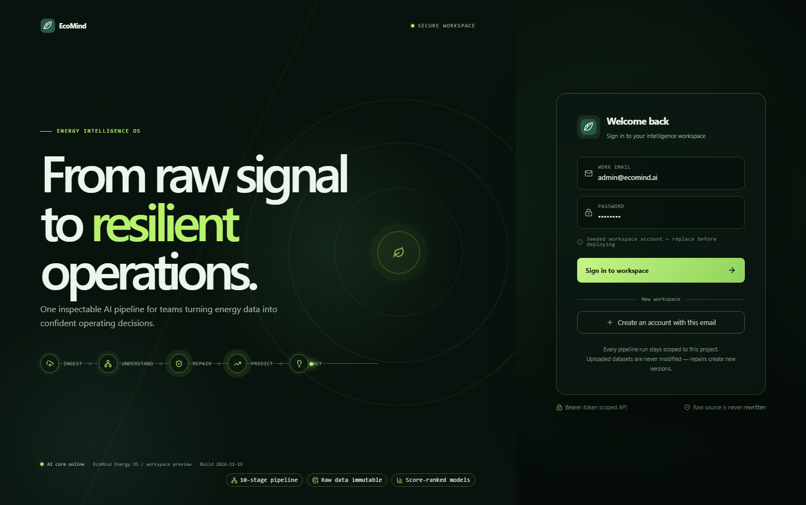
</p>

---

## Contents

- [Screenshots](#-screenshots)
- [Why EcoMind](#-why-ecomind)
- [The ten stages](#-the-ten-stages)
- [What makes it different](#-what-makes-it-different)
- [Architecture](#-architecture)
- [Quick start](#-quick-start)
- [Built-in datasets](#-built-in-datasets)
- [Project structure](#-project-structure)
- [Tests and CI](#-tests-and-ci)
- [Documentation](#-documentation)
- [Security](#-security)
- [Troubleshooting](#-troubleshooting)
- [Contributing](#-contributing)
- [License](#-license)

---

## 📸 Screenshots

Every frame below is a real run of **EcoMind Synthetic Campus (30-day hourly)**, captured
from the app at 1500×940 — nothing staged, nothing redrawn. The gallery covers the entry
screen, all ten pipeline stages, and the runtime health endpoint.

| Entry | Mission control |
|---|---|
|  | 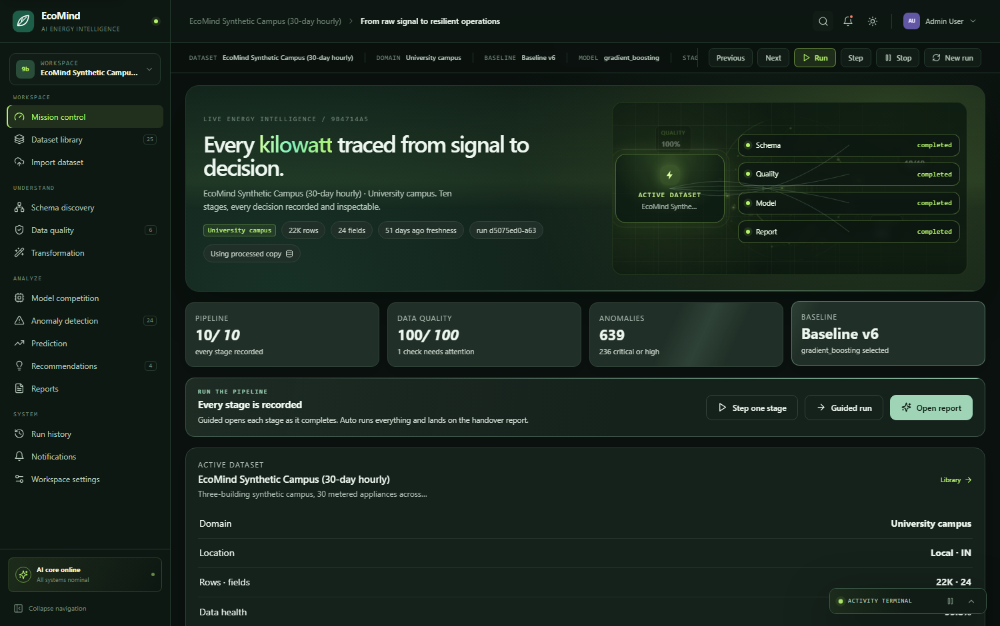 |
| **Entry** — secure workspace sign-in with the seeded demo account. | **Mission control** — stage completion, data-quality score, anomaly count, baseline version and the chosen model, all read from the recorded run. |

| Library | Import |
|---|---|
| 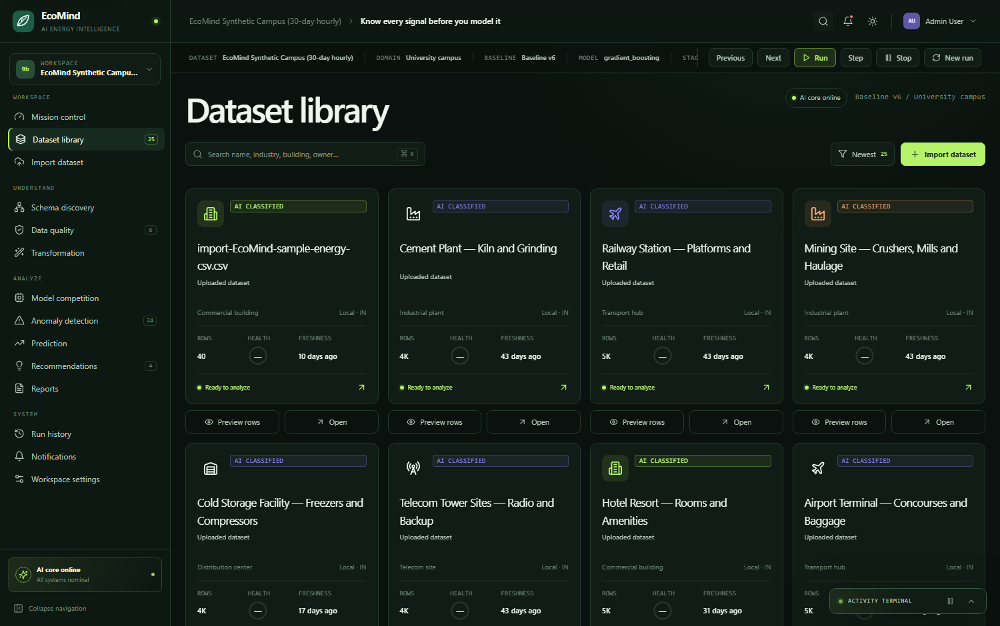 | 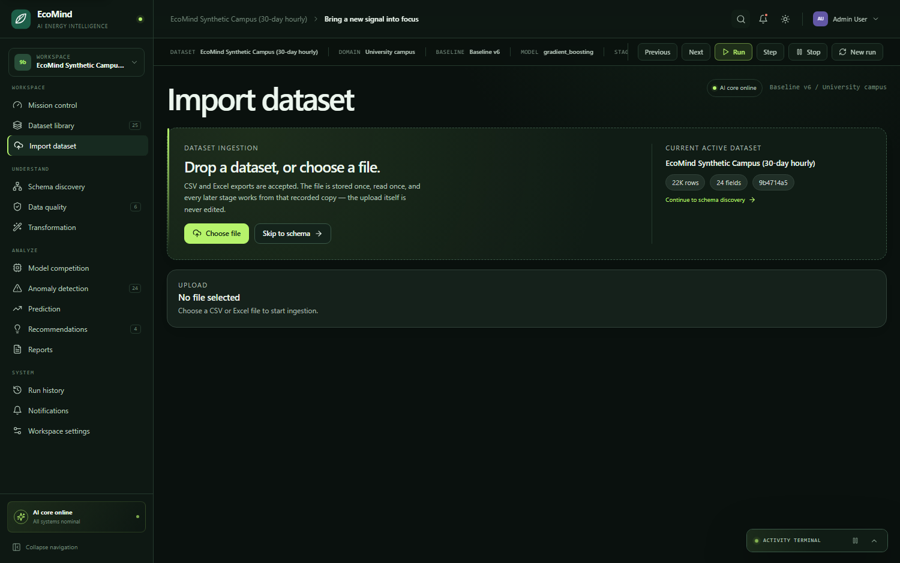 |
| **Library** — registered datasets with provenance, row/field counts and defect rates. | **Import** — upload a CSV or Excel file; raw source is preserved and repairs create new versions. |

| Schema | Data quality |
|---|---|
| 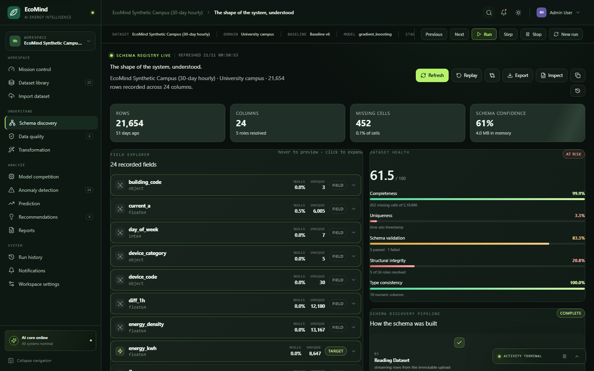 | 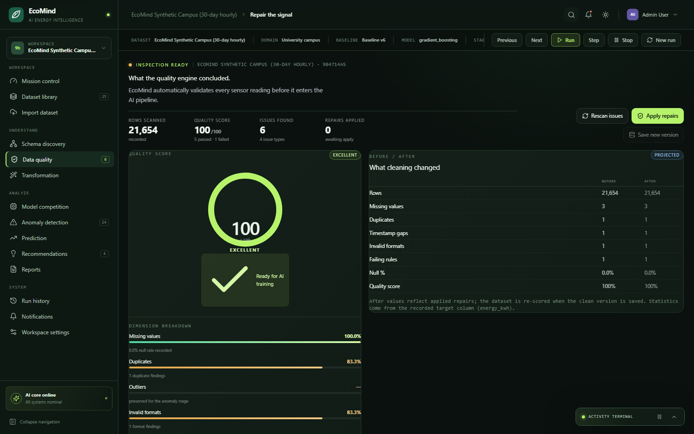 |
| **Schema** — every column, its detected type, the role it plays and the evidence for trusting it. | **Data quality** — structural rules across five dimensions, severity-scored; a critical rule passes only with zero violations. |

| Transformation | Model competition |
|---|---|
| 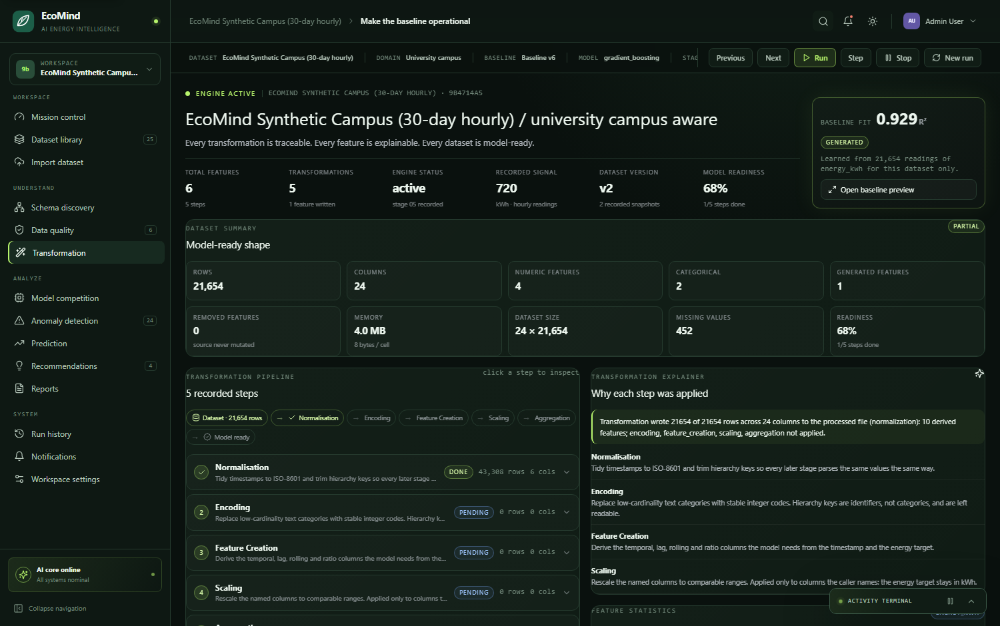 | 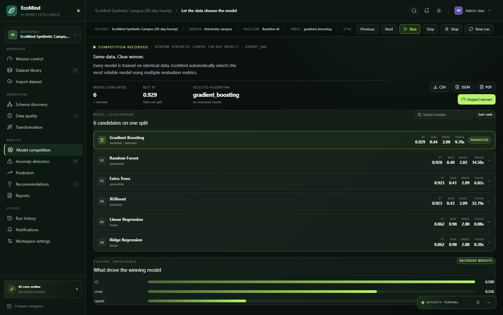 |
| **Transformation** — five recorded steps with field-level before/after, the hour-of-week normal-behaviour heatmap and feature importance. | **Model competition** — candidates on one held-out window, each with a written selection rationale; near-ties are labelled. |

| Anomalies | Prediction |
|---|---|
| 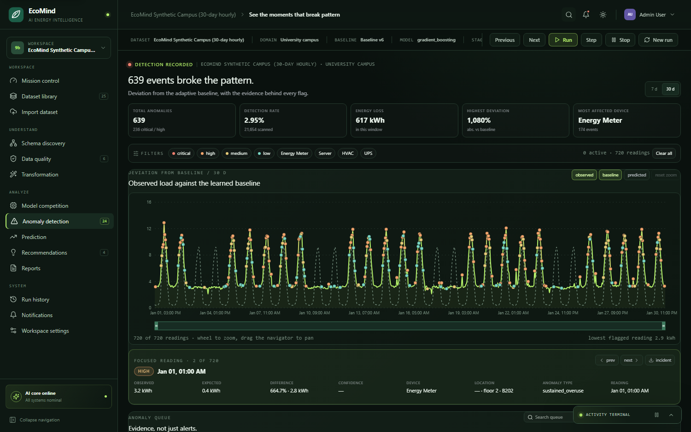 | 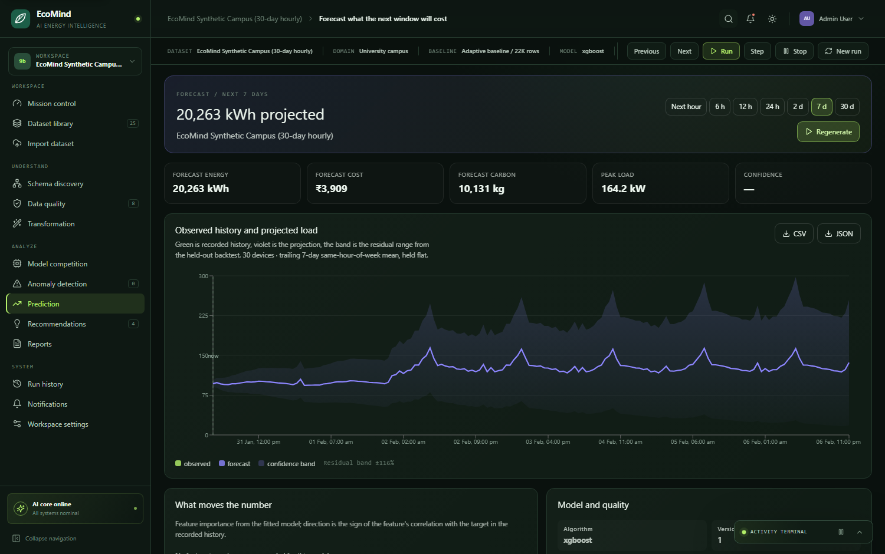 |
| **Anomalies** — waste events measured against each device's own hour-of-week baseline, with the baseline version recorded. | **Prediction** — observed history, projected load and the confidence band, with the naive hour-of-week baseline for comparison. |

| Recommendations | Reports |
|---|---|
| 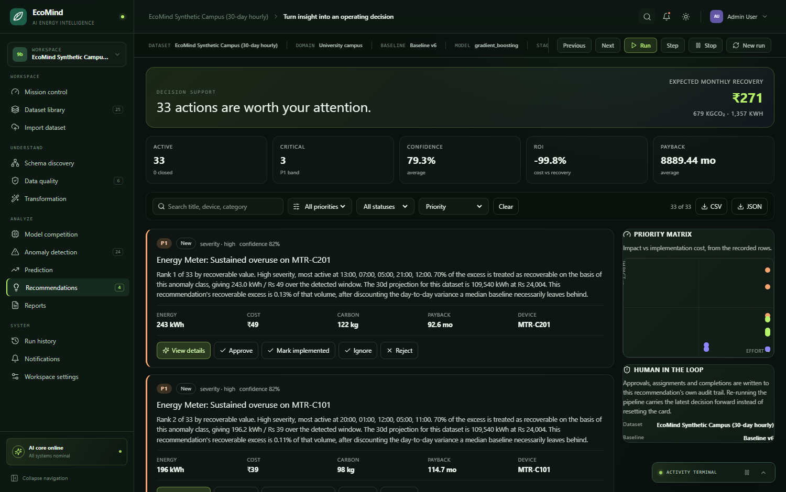 | 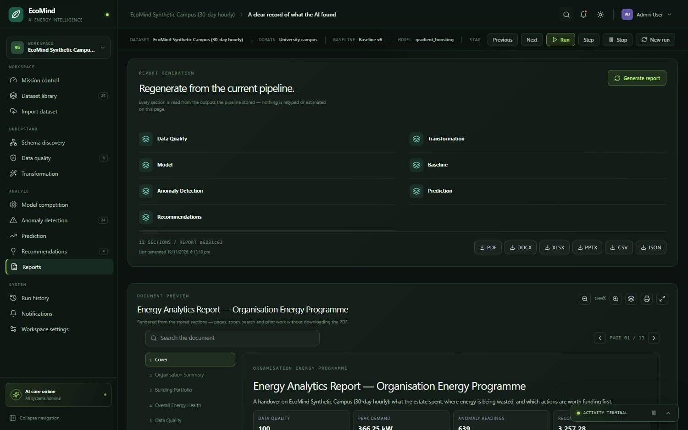 |
| **Recommendations** — ranked actions with their own energy, cost, carbon and payback, plus the impact-versus-effort matrix. | **Reports** — twelve sections in locked order, assembled from the same snapshots the earlier screens displayed. |

Runtime health is exposed locally at `GET /api/v1/health`; the recorded response is shown below.

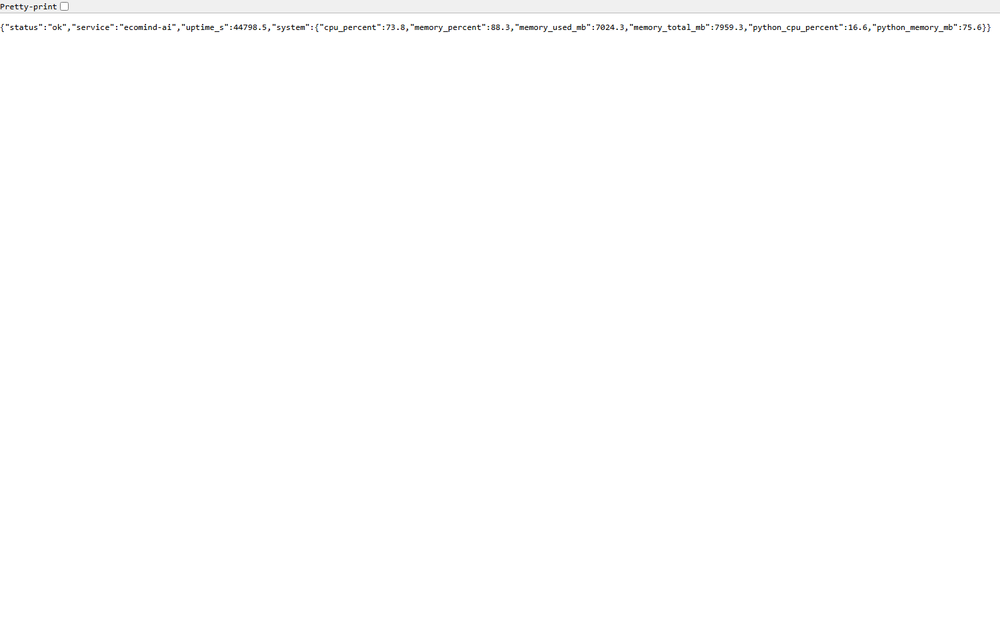

---

## ⚡ Why EcoMind

Most energy dashboards stop at a chart. They show a spike and leave the reader to
decide whether it is a fault, a festival, or a meter with a flat battery — and
they show it next to a prediction with no way to check whether the model that
produced it was any good.

EcoMind AI closes that gap with a **ten-stage pipeline in which every stage is
executed once and recorded**. A dataset is profiled, quality-scored, transformed,
used to race candidate models on one identical split, mined for anomalies
against each device's own hour-of-week baseline, projected forward with an
uncertainty band, priced into prioritised actions with payback verdicts, and
assembled into a report — built from the same snapshots the earlier screens
displayed.

The result is a platform for universities, hospitals, offices, manufacturing,
hotels, airports, malls and data centres where the answer to *"where did this
number come from?"* is always a run, a stage, and a version — never a shrug.

## 🔟 The ten stages

<p align="center">
  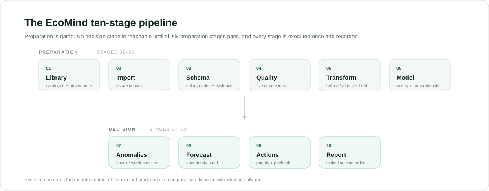
</p>

Preparation must all pass before any decision stage is reachable.

| # | Stage | What you get |
|---|-------|--------------|
| 1 | **Library** | Dataset library with provenance, row/column/device counts and defect rates |
| 2 | **Import** | Estate census: buildings, floors, rooms, devices, rows and date range |
| 3 | **Schema** | Every column, its detected type, the role it plays, and the evidence for trusting it |
| 4 | **Data Quality** | Structural rules across five dimensions, severity-scored; a critical rule passes only with zero violations |
| 5 | **Transformation** | Five steps (normalise, encode, scale, aggregate, derive) with field-level before/after |
| 6 | **Model Selection** | Candidates on one identical split, chosen on measured results — every candidate carries a written `selection_rationale`, near-ties stated |
| 7 | **Anomalies** | Where and when energy is wasted, measured against each device's own hour-of-week baseline — the baseline's version is recorded with every anomaly |
| 8 | **Forecast** | Hourly uncertainty band + per-horizon outlook, with the hour-of-week naive baseline for comparison |
| 9 | **Recommendations** | Prioritised actions with receipts, savings inventory, payback verdicts and a programme roll-up |
| 10 | **Report** | Twelve sections in locked order, assembled from the recorded stage outputs |

A stage is executed once and recorded. Every screen reads that stage's own
recorded output, so no page can disagree with what actually ran. Adaptive
baselines, artifact versions and audit events are persisted and browsable.

## 🎯 What makes it different

| Principle | How it shows up in the product |
|---|---|
| **One split, no exceptions** | Every model candidate is trained and scored on the same held-out window; the winner is chosen on measured results, not on reputation. Near-ties are labelled as near-ties. |
| **A baseline per device** | Anomalies are judged against that device's own hour-of-week behaviour, not a site-wide average — so a canteen at 08:00 is never compared with a server room at 03:00. |
| **Rationale is stored, not implied** | Each candidate's `selection_rationale`, each baseline's version and each anomaly's evidence are written to the database with the run. |
| **The report states figures in prose** | Any number that appears in a table also appears in the sentence around it, so a screenshot of one paragraph cannot be quoted out of context. |
| **Honest payback** | When an action's payback is poor, the report says the payback is poor. A recommendation that cannot justify itself is not dressed up as one that can. |
| **Vocabulary that follows the field** | Load a solar plant and the UI speaks in generation; load a cement kiln and it speaks in clinker, not in kWh. |

## 🧱 Architecture

```
┌─────────────────────────────────────────────────────────────┐
│                      EcoMind AI Platform                    │
├────────────────────────────┬────────────────────────────────┤
│  React 19 + TypeScript     │   FastAPI + SQLAlchemy         │
│  Vite · TanStack Query     │   JWT auth · SSE streaming     │
│  Recharts · lucide icons   │   pandas · scikit-learn        │
│  serves from frontend/dist │   hour-of-week baselines       │
└────────────────────────────┴────────────────────────────────┘
```

- **`backend/`** — FastAPI REST + SSE API, JWT auth, SQLAlchemy, one service per
  stage; also serves the built SPA from `frontend/dist/` on **:8000**
- **`frontend/`** — Vite + React SPA (`client/src/`), pnpm, builds to `frontend/dist/`
- **`launcher/`** — the one start path (bootstrap, checks, spawn, stop, monitor)
- **`docs/`** — [`STATUS.md`](docs/STATUS.md) (what is built, broken, next) plus the
  IEEE paper, the project report, design decisions and release evidence

## 🚀 Quick start

**One click. From a bare clone:**

| Platform | Command |
|---|---|
| Windows | double-click **`ecomind.bat`** |
| macOS / Linux | `./ecomind.sh` |

The launcher installs anything missing (Python 3.10+, Node 18+, `.venv`,
backend requirements, `pnpm install`), generates `backend/.env` with a random
secret key, seeds the database with the built-in dataset catalogue, starts the
backend, waits until it is healthy, and opens your browser.

Then open **<http://127.0.0.1:8000>** and sign in:

```
Email:    admin@ecomind.ai
Password: admin123
```

Other commands (same entry point):

```
ecomind start     start the app (default)
ecomind stop      stop every service
ecomind check     report on the machine without changing it
ecomind verify    install everything, prove it worked, exit
```

The first run takes a few minutes while dependencies download; later runs start
in seconds. Steps are idempotent and keyed on file hashes.

> **If Python was just installed**, close the window and run it again — the
> launcher cannot swap the interpreter it is itself running under, and it says
> so rather than pretending otherwise.

### Manual setup (developers)

```bash
# Backend — the virtualenv lives at the repository root (.venv)
python -m venv .venv
.venv/Scripts/activate          # Windows
source .venv/bin/activate        # macOS / Linux

pip install -r backend/requirements.txt
python backend/seed.py           # generate the catalogue + admin user
python -m uvicorn app.main:app --host 127.0.0.1 --port 8000
# → http://127.0.0.1:8000 (serves the built SPA from frontend/dist/)
```

```bash
# Frontend — only needed for vite HMR; proxies /api to :8000
cd frontend
pnpm install
pnpm dev:static                  # → http://127.0.0.1:5173
```

`make help` lists the same commands as targets (`install`, `seed`, `backend`,
`frontend`, `dev`, `test`, `demo`, `clean`).

## 📦 Built-in datasets

A fresh clone needs no downloads — setup generates and registers:

| Dataset | What it is |
|---|---|
| **EcoMind Healthy Campus** | 2 buildings · 26 rooms · 102 devices · 90 days hourly — clean baseline with only trace noise |
| **EcoMind Fault Simulation Campus** | The same estate with injected faults: stuck meters, an HVAC failure, sensor dropouts, spikes and occupancy mismatches |
| **BDG2 Electricity Meters** | 3-year hourly **open data** (UCI ElectricityLoadDiagrams20112014 via Zenodo 3898439), 9 building meters |

Regenerate them without the launcher:
`python scripts/build_datasets.py` (`--dataset healthy|faulty|reference|all`).

### Twenty more fields — not a buildings-only tool

`scripts/build_field_datasets.py` generates and registers **twenty energy
domains**, each with its own hierarchy codes, equipment, cadence and target
column, and each deterministic so a re-run reproduces the same file:

| Field | Target | Field | Target |
|---|---|---|---|
| Commercial building | `energy_kwh` | Solar PV plant | `generation_kwh` |
| Manufacturing plant | `energy_kwh` | Wind farm | `generation_kwh` |
| Hospital | `energy_kwh` | EV charging hub | `energy_kwh` |
| University campus | `energy_kwh` | District heating | `heat_kwh` |
| Shopping mall | `energy_kwh` | Water treatment | `energy_kwh` |
| Warehouse / cold chain | `energy_kwh` | Airport terminal | `energy_kwh` |
| Office complex | `energy_kwh` | Hotel resort | `energy_kwh` |
| Data centre | `energy_kwh` | Telecom tower site | `energy_kwh` |
| Cold storage facility | `energy_kwh` | Mining site | `energy_kwh` |
| Railway station | `energy_kwh` | Cement plant | `energy_kwh` |

```bash
python scripts/build_field_datasets.py            # write + register
python scripts/build_field_datasets.py --prune    # replace its own earlier uploads
python scripts/build_field_datasets.py --no-upload --days 30
```

Each file carries a planted fault window (so anomaly detection has something
real to find) and one malformed row (so the quality stage has a real defect to
repair). The CSVs land in `sample-datasets/`, which is gitignored — re-run the
script to recreate them.

The frontend adapts to whichever field is loaded: the domain vocabulary, the
unit vocabulary and the signal-family vocabulary all cover generation,
transport, telecom and water quantities, so a solar plant is not labelled a
manufacturing plant and `clinker_tonnes` is not labelled `kWh`.

## 📁 Project structure

```
EcoMind-AI/
├── backend/
│   ├── app/
│   │   ├── core/          # config, security (JWT), execution runtime
│   │   ├── db/            # SQLAlchemy models & session
│   │   ├── domain/        # one service per stage + baselines, snapshots
│   │   ├── routes/        # auth, datasets, workflow, baseline, activity
│   │   └── workflow/      # ten-stage orchestration + SSE event bus
│   ├── requirements.txt
│   ├── seed.py            # demo data generator
│   └── tests/             # pytest suite (API, detectors, launcher, exports)
├── frontend/
│   ├── client/src/        # the SPA: shell, views, lib (api, workspace loader)
│   ├── shared/            # shared constants
│   ├── vite.config.ts     # builds to frontend/dist (served by FastAPI)
│   └── package.json       # pnpm (packageManager: pnpm@10.18.0)
├── launcher/              # bootstrap, checks, spawn, stop — one start path
├── scripts/               # dataset builders, demo run, paper measurements
├── docs/                  # report, changelog, decisions, status, IEEE paper
├── ecomind.bat / .sh      # the single entry point per platform
├── Dockerfile             # single-image deployment (seeds at build time)
└── Makefile               # the same commands as targets
```

## 🧪 Tests and CI

```bash
# Backend — pytest
python -m pytest -q

# Frontend — typecheck + production build
cd frontend
pnpm check
pnpm build:static
```

Three CI jobs run on every push and pull request
([`.github/workflows/ci.yml`](.github/workflows/ci.yml)):

1. **Frontend** — `pnpm check`, `pnpm build:static`, plus a hard 1000 kB ceiling
   on the entry chunk.
2. **Backend** — seed the database, then the full pytest suite.
3. **One-click bootstrap** — a bare checkout runs `./ecomind.sh verify` and then
   proves the seeded admin user authenticates, which is the regression that a
   pinned `passlib` once shipped past every ordinary test run.

## ☁️ Deploying on Render

The repository ships a [`render.yaml`](render.yaml) blueprint and a multi-stage
[`Dockerfile`](Dockerfile). In Render, choose **New → Blueprint**, point it at
this repository, and apply. The image builds the SPA and seeds the catalog at
build time, so a cold start only has to start uvicorn.

The blueprint sets `ECOMIND_ENV=production`, generates `ECOMIND_SECRET_KEY`, and
caps training rows with `ECOMIND_ML_SAMPLE_ROWS`. Set that cap higher on a plan
with more RAM and CPU when you need to train on larger datasets.

Deployment storage is the part that used to fail mid-run: a model race wrote
five uncompressed estimators, some over a gigabyte, into `backend/data/models`
until the instance disk filled. Now artifacts are compressed, only the selected
model's file is kept, and any stale artifacts are pruned at startup, so a normal
run stays well inside a small disk. For durable data across deploys, attach a
persistent disk mounted at `/app/backend/data`.

## 📚 Documentation

| Document | Description |
|---|---|
| [`docs/PROJECT_REPORT.md`](docs/PROJECT_REPORT.md) | **End-to-end report** — architecture, the stage-by-stage pipeline, API surface, verified status, demo script |
| [`docs/STATUS.md`](docs/STATUS.md) | Backend truth: what is implemented, what is deliberately absent |
| [`docs/CHANGELOG.md`](docs/CHANGELOG.md) | Every change, with the evidence it was verified against |
| [`docs/DESIGN_DECISIONS.md`](docs/DESIGN_DECISIONS.md) | The design system and the reasoning behind each decision |
| [`docs/EcoMind_IEEE_Paper.tex`](docs/EcoMind_IEEE_Paper.tex) | IEEE-format technical paper (+ `docs/research/` assets) |
| [`docs/open-source-credits.md`](docs/open-source-credits.md) | Vendored components and their licences |

## 🔒 Security

- **Passwords** are hashed with [`bcrypt`](https://pypi.org/project/bcrypt/) at
  cost 12, called directly rather than through `passlib`. `passlib` 1.7.4 —
  pinned until 2026-10-04 — raises `ValueError` against `bcrypt` 4.1+, so a fresh
  install could not create a user at all. It is gone for that reason, not for
  style. Existing password hashes still verify.
- `ECOMIND_SECRET_KEY` is **generated randomly on first launch** and written to
  `backend/.env`. If it is ever missing, too short, or still the placeholder from
  `.env.example`, the launcher replaces it on the next start. Never commit
  `backend/.env`; it is gitignored.
- Demo credentials (`admin@ecomind.ai` / `admin123`) are for local evaluation
  only. Change or disable them before exposing the API.
- JWTs expire in 24 h and every protected route requires `Authorization: Bearer`.
- SSE uses a **60-second, single-purpose stream token** minted by
  `POST /api/v1/workflows/{run_id}/stream-token` — ordinary session tokens are
  rejected there, so a 24-hour credential can never land in access logs.

To report a vulnerability, read [`SECURITY.md`](SECURITY.md) instead of opening a
public issue.

## 🩺 Troubleshooting

| Symptom | Cause | Fix |
|---|---|---|
| `No Python interpreter found` | Nothing installed, or the Microsoft Store `python` alias is intercepting | The launcher installs it automatically via winget/Chocolatey/Homebrew/apt. If that fails, install from [python.org](https://www.python.org/downloads/) and tick **Add python.exe to PATH**, then reopen the terminal. |
| Installed Python, still says none found | The shell's PATH predates the install | Close the window and run the launcher again. |
| `[FAIL] Seeding failed` | Read `logs/launcher.log` — usually a dependency that failed to install | Run `.\ecomind.bat check`, then re-run. |
| Port 8000 already in use | Another process holds it | `.\ecomind.bat stop`, or change the port in `launcher/config.json`. |
| A page renders but shows no data | That pipeline stage has not run for this dataset | Press **Run** in the bar at the top of any page, or **Step** to advance one stage. |
| `ECOMIND_SECRET_KEY is the development placeholder` | `backend/.env` was deleted or never generated | Run `.\ecomind.bat` — it regenerates one. |

Useful logs: `logs/launcher.log` (bootstrap), `logs/backend.log`.

## 🎬 Running a demonstration

The run controls live in the bar under the topbar, on **every** page, so a
walkthrough never has to hunt for them:

| Control | What it does |
|---|---|
| **Run** | Executes every remaining stage, then opens the executive report |
| **Step** | Executes exactly one stage |
| **Stop** | Aborts the active run; everything recorded before the stop is kept |
| **New run** | Starts a fresh run for the active dataset from stage 01 |

All four work on a dataset that has never been analysed — they start a run when
none exists rather than sitting disabled. **Guided tour** on Mission control
additionally opens each page as its stage completes, so the pipeline can be
narrated. A short chime marks the start of a run and another marks its
completion. A ten-minute script is in
[`docs/PROJECT_REPORT.md`](docs/PROJECT_REPORT.md) §10.

## 🤝 Contributing

Issues and pull requests are welcome. Start with
[`CONTRIBUTING.md`](CONTRIBUTING.md) for the setup, the commit convention and the
checks that must be green before a pull request is reviewed, and
[`CODE_OF_CONDUCT.md`](CODE_OF_CONDUCT.md) for how we work together.

## 🗺️ Roadmap

- [ ] Archive orphaned/failed workflow runs so the library and run history stay clean
- [ ] Docker Compose for one-command full-stack startup
- [ ] Multi-tenant workspaces with role-based access
- [ ] Live meter integrations (MQTT / Modbus / BACnet)
- [ ] Scheduled retraining with drift detection

## 📄 License

Released under the [MIT License](./LICENSE).

---

<div align="center">

Built with ⚡ by **Shashank Gowda N C** — [GitHub](https://github.com/shashu123456) · Bengaluru, India

</div>
